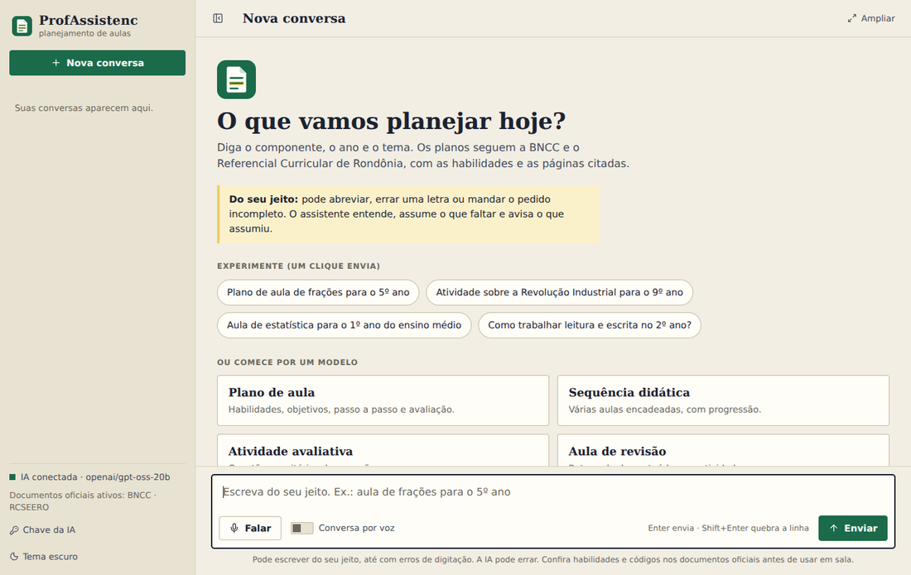
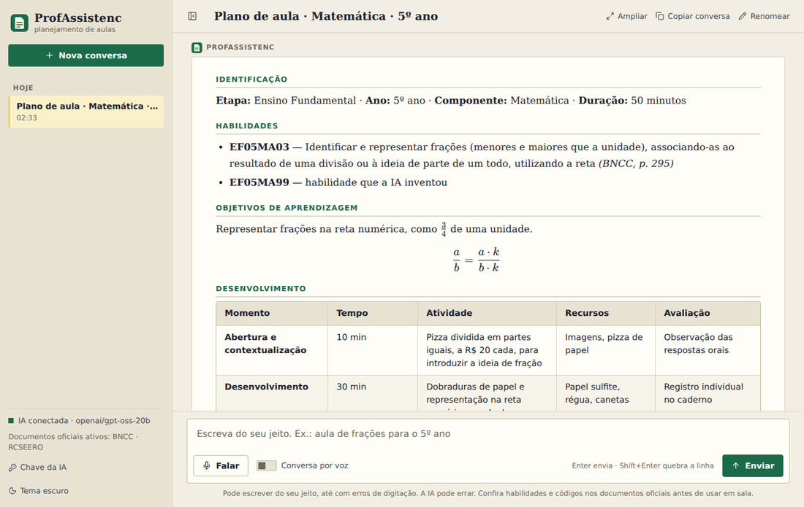
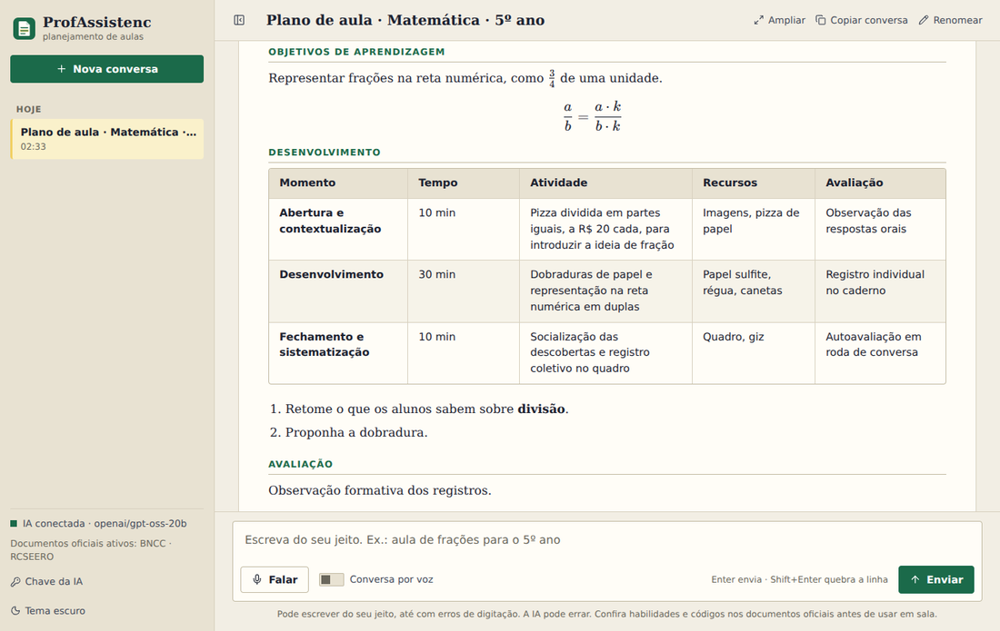
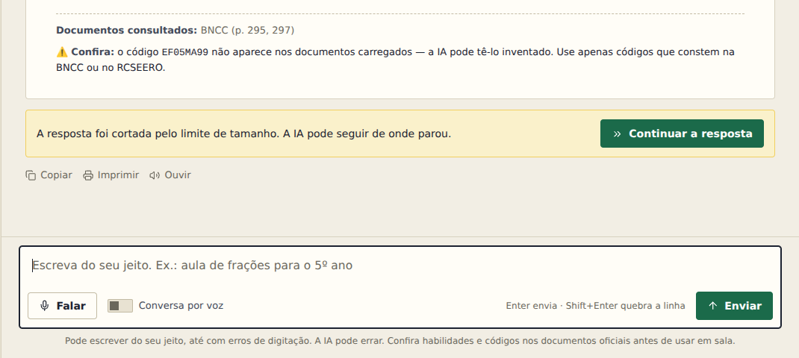
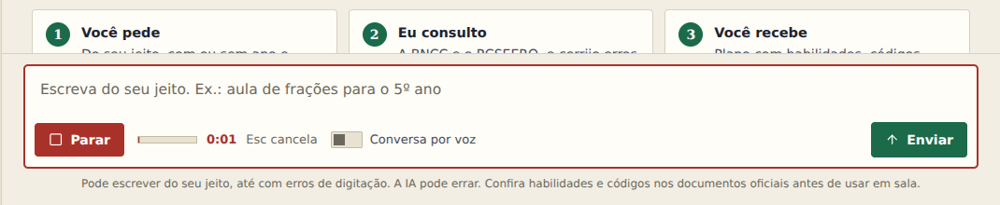
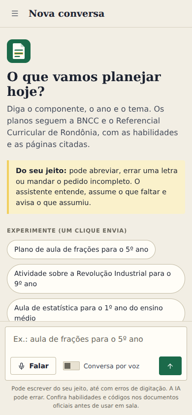

# Guia do Professor: como usar o ProfAssistencIA

O ProfAssistencIA ajuda você a **planejar aulas**: 

- Planos de aula, sequências didáticas, atividades, avaliações e adaptações. 

Ele consulta a **BNCC** e o **Referencial Curricular do Ensino Médio de Rondônia (RCSEERO)** para que o plano tenha as habilidades e as páginas dos documentos oficiais.

> Ainda não instalou? Veja o **[Guia de Instalação para Professores](INSTALACAO_PROFESSORES.md)**.
> As imagens deste guia usam respostas de exemplo (uma IA simulada), só para mostrar a tela.

## 1. A tela

* **Menu à esquerda:** **Nova conversa**, o **histórico** das suas conversas, o estado da IA, o botão **Chave da IA** e a troca entre tema claro e escuro.
* **Centro:** a conversa. Na primeira vez, aparecem exemplos para clicar e modelos de pedido.
* **Embaixo:** a caixa onde você escreve, o botão **Falar** (microfone) e **Enviar**.
* **Em cima, à direita:** **Ampliar** (usa mais espaço da tela), **Copiar conversa** e **Renomear**.
* **Botão ◧ no alto à esquerda:** recolhe o menu lateral para ganhar espaço.

## 2. Como fazer um pedido

**Escreva do seu jeito.** Não precisa de fórmula nem de palavras certas. Funcionam pedidos assim:

* *Plano de aula de frações para o 5º ano*
* *Atividade sobre a Revolução Industrial para o 9º ano*
* *Como trabalhar leitura e escrita no 2º ano?*
* *aula de matematca pro 5 ano sobre fraçoes* (até com erros de digitação)
* *Ideias para uma aula de ciências* (incompleto: o assistente assume o que faltar e **avisa o que assumiu**, para você ajustar)

**Quanto mais você disser, mais certeiro fica.** O ideal é informar:

| O que | Exemplo |
| --- | --- |
| **Componente** | Matemática, Língua Portuguesa, História… |
| **Ano ou série** | 5º ano, 1º ano do Ensino Médio |
| **Tema** | frações, a República, ciclo da água |
| **Duração** | 50 minutos, 4 aulas |
| **A turma** (se importar) | turma com muita dificuldade em leitura |

> Exemplo completo: *Plano de aula de ciências para o 4º ano sobre o ciclo da água, 50 minutos, com uma atividade em grupo.*

### Modelos de pedido

Na tela inicial há **modelos** (Plano de aula, Sequência didática, Atividade avaliativa, Aula de revisão). Clique em um: ele preenche a caixa com campos entre **[colchetes]**. Digite no campo selecionado e use a tecla **Tab** para pular para o próximo. Se esquecer algum campo, o programa avisa uma vez; apertar **Enviar** de novo manda assim mesmo.

### Peça ajustes na mesma conversa

Depois do primeiro plano, continue a conversa. O assistente lembra do que já foi dito:

* *Deixe mais curto.*
* *Adapte para uma turma de 30 alunos, sem computador.*
* *Agora faça a mesma aula para o 6º ano.*
* *Acrescente uma atividade de avaliação com 5 questões.*
* *Explique melhor a parte do desenvolvimento.*

## 3. Entendendo a resposta

O plano costuma vir em seções: **Identificação**, **Habilidades**, **Objetos de conhecimento**, **Objetivos de aprendizagem**, **Desenvolvimento** (com o tempo de cada momento), **Recursos**, **Avaliação** e **Adaptações**.

No fim da resposta aparecem duas informações importantes:

* **Documentos consultados**, por exemplo *BNCC (p. 295, 297)*: as páginas dos documentos oficiais que o programa entregou à IA. **Confira nelas as habilidades antes de usar.** Isso mostra o que foi consultado, mas não garante que a IA usou cada trecho.
* **⚠️ Confira:** aparece quando a IA citou um **código de habilidade que não existe** nos documentos (por exemplo, `EF05MA99`). Esse código pode ter sido inventado. **Não use** códigos marcados assim. Procure o código correto no documento.

> **Regra de ouro:** a IA é uma ajudante, não a responsável pelo plano. **Leia, confira e adapte à sua turma** antes de usar.

### Quando a resposta é cortada

Planos muito longos podem ser cortados pelo limite de tamanho. Aparece uma faixa amarela com o botão **Continuar a resposta**. Clique nele, e a IA segue de onde parou.

## 4. Botões de cada resposta

Embaixo de cada resposta:

* **Copiar:** copia o texto para colar no Word, no Google Docs ou em um e-mail.
* **Imprimir:** imprime **só aquele plano**, com título e data, sem menus. Na janela de impressão você pode escolher "Salvar como PDF".
* **Ouvir:** o computador lê a resposta em voz alta. Clique de novo para parar.

## 5. Falar em vez de digitar

1. Clique em **Falar**. Na primeira vez, o navegador pergunta se pode usar o microfone: clique em **Permitir**.
2. Fale o seu pedido. A barrinha mostra que o microfone está ouvindo e o relógio conta o tempo.
3. Clique em **Parar**. O texto aparece na caixa para você **revisar**; depois é só **Enviar**.
4. Para cancelar a gravação, aperte **Esc**.

**Conversa por voz:** ligue a chave ao lado do botão. Daí a sua fala é **enviada sozinha** e a resposta é **lida em voz alta**, como uma conversa.

> Dicas: fale perto do microfone e em lugar sem muito barulho. A gravação funciona pelo endereço `localhost:5000` (o programa já abre assim). A voz da leitura depende do computador: no Windows costuma haver uma voz em português.

## 6. Suas conversas

* Cada pedido novo vira uma **conversa**, com título automático (por exemplo, *Plano de aula · Matemática · 5º ano · frações*), guardada no **menu da esquerda**.
* Clique numa conversa para reabrir e continuar de onde parou.
* Passe o mouse sobre ela para **renomear** (lápis) ou **excluir** (lixeira).
* **Copiar conversa**, no alto da tela, copia a conversa inteira.
* **Nova conversa** começa do zero. Use quando mudar de assunto: a IA responde melhor com a conversa focada.

As conversas ficam **no seu computador**, e continuam lá quando você fecha e abre o programa.

## 7. No celular

Esta versão é para o **computador**. O programa não funciona no celular. Se quiser ver um plano no celular, use **Copiar** e envie para você mesmo (por e-mail ou WhatsApp).

*(A imagem mostra como a tela se ajusta a espaços estreitos.)*

## 8. Limites do plano gratuito

A chave gratuita da Groq tem limites:

* **Por minuto:** cada plano longo usa boa parte do limite. Pedir **dois planos longos em menos de um minuto** pode dar a mensagem *"Limite de uso da IA atingido. Tente novamente em N…"*. É só esperar o tempo indicado.
* **Por dia:** há um limite diário, que dá, em geral, para **algumas dezenas de planos por dia**. Se acabar, volta no dia seguinte.

Se a sua escola precisar de mais, o coordenador pode usar um plano pago da Groq.

## 9. Dicas para resultados melhores

* **Informe o ano e o componente.** É o que mais ajuda o programa a achar as habilidades certas.
* **Uma coisa por vez.** Peça o plano; depois peça os ajustes.
* **Confira os códigos** e as páginas indicadas (veja o item 3).
* **Use "Nova conversa"** quando trocar de turma ou de assunto.
* **Se a resposta vier estranha**, reformule o pedido com mais detalhes, ou peça: *"Refaça considerando…"*.

## 10. Perguntas frequentes

**É grátis?** O programa é gratuito. A chave da Groq tem um plano gratuito com limites (item 8).

**Funciona sem internet?** Não. O programa abre, mas a IA precisa de internet para responder.

**A IA erra?** Sim, pode errar. Por isso o programa mostra os documentos consultados e avisa sobre códigos inexistentes. **Sempre confira o plano.**

**Posso confiar nas habilidades da BNCC que ela cita?** Quando o código está correto, ele vem dos documentos oficiais. Mesmo assim, **confira a página indicada**. Se aparecer o aviso ⚠️, não use o código.

**Para que etapas serve?** A **BNCC** cobre Educação Infantil, Ensino Fundamental e Ensino Médio. O **RCSEERO** é o referencial de Rondônia para o **Ensino Médio**. Para Educação Infantil e Fundamental, o programa usa só a BNCC (ainda não há o referencial estadual nele).

**Posso usar para provas e atividades?** Sim: peça *atividade avaliativa* ou *prova*. Revise as questões e o gabarito.

**Quem vê o que eu escrevo?** O texto (e a voz) é enviado à **Groq** para gerar as respostas. As conversas ficam guardadas só no seu computador. **Não coloque nomes ou dados pessoais de estudantes.**

**Posso mudar a chave?** Sim, pelo botão **Chave da IA**, no menu.

**Apaguei uma conversa sem querer.** Não dá para desfazer. Por isso, às vezes vale fazer uma cópia do arquivo `profassistenc.db` (veja o [Guia de Instalação para Professores](INSTALACAO_PROFESSORES.md#guardar-uma-cópia-das-suas-conversas-backup)).

**A janela preta precisa ficar aberta?** Sim: ela é o programa. Pode minimizar. Para sair, feche-a.
