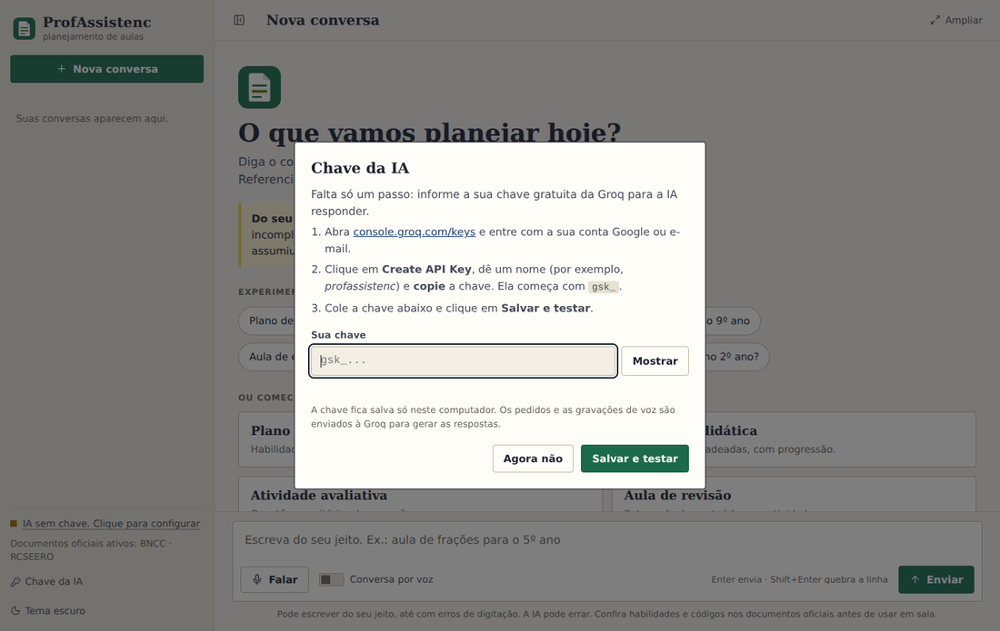

# Instalando o ProfAssistencIA no seu computador

Este guia é para **professores**. Você não precisa saber de informática: basta seguir os passos, na ordem. 
Leva uns **10 minutos** e é feito **uma única vez**.

> **Resumo em 5 linhas**
> 1. Baixe o arquivo `ProfAssistenc-...-windows.zip` e **extraia** (não abra de dentro do zip).
> 2. Dê dois cliques em **ProfAssistenc**.
> 3. Se o Windows avisar, clique em **Mais informações → Executar assim mesmo**.
> 4. Na primeira vez, cole a sua **chave gratuita da Groq** (o programa explica como conseguir).
> 5. Pronto: escreva o que precisa e peça o seu plano de aula.

## Antes de começar

Você precisa de:

| O quê | Observação |
| --- | --- |
| Um computador com **Windows 10 ou 11** | Para Linux ou macOS, veja o fim deste guia |
| **Internet** | A IA funciona pela internet; sem ela o programa abre, mas não responde |
| Um navegador (Chrome, Edge, Firefox…) | O programa abre no seu navegador padrão |
| Uma conta **Google ou e-mail** | Só para criar a chave gratuita (passo 4) |
| Cerca de **200 MB livres** no disco | O programa ocupa menos de 100 MB depois de extraído |

**Você não precisa instalar Python, nem ser administrador do computador.**

## Há dois jeitos de instalar. Use o que a sua escola indicar

| Jeito | Como reconhecer | Para quem é |
| --- | --- | --- |
| **A. Pasta (zip)** | Arquivo `ProfAssistenc-2.1.0-windows.zip` | O mais simples; funciona até em computador sem permissão de instalar programas |
| **B. Instalador** | Arquivo `ProfAssistenc-Setup-2.1.0.exe` | Cria atalhos no menu Iniciar e na Área de Trabalho sozinho |

Os dois fazem a mesma coisa. Se você recebeu o **instalador (B)**, vá direto para o [passo 3](#jeito-b-pelo-instalador).

---

## Jeito A: pela pasta (zip)

### Passo 1. Baixe o arquivo

Baixe o arquivo `ProfAssistenc-2.1.0-windows.zip` pelo link que a sua escola ou coordenação enviou. Ele fica, em geral, na pasta **Downloads**.

### Passo 2. Extraia o zip numa pasta sua

> ⚠️ **Este é o erro mais comum:** abrir o programa de dentro do zip. Ele não funciona assim. É preciso **extrair** primeiro.

1. Clique com o **botão direito** no arquivo `.zip`.
2. Escolha **Extrair tudo…**
3. Em "Selecionar um destino", clique em **Procurar** e escolha um lugar seu, como **Documentos** ou **Área de Trabalho**.
4. Clique em **Extrair**.

Vai aparecer uma pasta chamada **ProfAssistenc**. **Não coloque em "Arquivos de Programas"**, e não apague essa pasta depois: ela guarda o programa, as suas conversas e a sua chave.

### Passo 3. Abra o programa

1. Abra a pasta **ProfAssistenc**.
2. Dê **dois cliques** em **ProfAssistenc** (o ícone verde com uma folha).

Vão acontecer duas coisas:

* uma **janela preta** aparece. Ela **é o programa funcionando**: deixe-a aberta (pode minimizar);
* o seu **navegador abre sozinho** na tela do ProfAssistenc.

> **Se o Windows mostrar "O Windows protegeu o computador"** (tela azul):
> o programa é novo e ainda não tem assinatura digital paga. Ele é seguro quando vem da sua escola.
> Clique em **Mais informações** e depois em **Executar assim mesmo**.
>
> **Se o antivírus bloquear ou apagar o arquivo:** libere a pasta **ProfAssistenc** nas exceções do antivírus, ou peça ajuda ao suporte da escola. É um aviso comum em programas novos, e não indica problema com o seu computador.

Se o navegador **não abrir sozinho**, abra você mesmo e digite na barra de endereço: `localhost:5000`

### Passo 4. Informe a sua chave da IA (só na primeira vez)

Na primeira abertura aparece a janela **"Chave da IA"**:

A chave é como uma "senha" gratuita que permite ao programa usar a inteligência artificial da Groq. Cada professor usa a sua. Para conseguir:

1. Clique no link **console.groq.com/keys** (abre em outra aba) e **entre com a sua conta Google ou e-mail**. Se não tiver conta na Groq, ela é criada na hora, de graça.
2. Clique em **Create API Key**. Dê um nome qualquer (por exemplo, *profassistenc*) e confirme.
3. **Copie** a chave que aparece. Ela começa com `gsk_`. *(Ela só aparece uma vez: copie antes de fechar.)*
4. Volte ao ProfAssistenc, **cole** a chave no campo e clique em **Salvar e testar**.

O programa testa a chave. Se estiver certa, aparece **"Chave salva. Tudo pronto"**. Se der erro, confira se copiou a chave **inteira**, sem espaços. O botão **Mostrar** deixa você ver o que colou.

Isso é feito **só uma vez**: da próxima vez, é só abrir o programa. Para trocar a chave depois, use o botão **Chave da IA**, no menu à esquerda.

### Passo 5. Faça o seu primeiro pedido

Experimente um dos exemplos da tela inicial (um clique já envia), ou escreva do seu jeito:

> *Plano de aula de frações para o 5º ano*

Em alguns segundos aparece o plano, com as habilidades da BNCC e as páginas do documento. Para aprender a tirar o melhor proveito, veja o **[Guia do Professor](GUIA_DO_PROFESSOR.md)**.

### Para abrir mais rápido: crie um atalho

1. Na pasta **ProfAssistenc**, clique com o botão direito em **ProfAssistenc**.
2. Escolha **Enviar para → Área de trabalho (criar atalho)**.

Agora é só dar dois cliques no atalho da Área de Trabalho.

---

## Jeito B: pelo instalador

1. Dê dois cliques em `ProfAssistenc-Setup-2.1.0.exe`.
2. Se o Windows avisar, clique em **Mais informações → Executar assim mesmo**.
3. Clique em **Avançar**, deixe marcada a opção de criar o atalho na Área de Trabalho e clique em **Instalar**.
4. Ao terminar, deixe marcado **Abrir o ProfAssistenc agora** e clique em **Concluir**.
5. Faça o [Passo 4](#passo-4-informe-a-sua-chave-da-ia-só-na-primeira-vez) (chave) e o [Passo 5](#passo-5-faça-o-seu-primeiro-pedido).

Não pede senha de administrador. Depois, abra pelo atalho da Área de Trabalho ou pelo menu Iniciar.

---

## No dia a dia

* **Abrir:** dois cliques no ícone. A janela preta aparece e o navegador abre.
* **Sair:** feche a **janela preta**.
* **Abriu duas vezes sem querer?** Não tem problema: o programa percebe e só abre o navegador de novo.
* **Fechei o navegador, e agora?** O programa continua rodando na janela preta. Abra o navegador e digite `localhost:5000`, ou dê dois cliques no ícone de novo.

## Atualizar para uma versão nova

Quando receber um zip ou instalador novo:

* **Pelo instalador:** execute o novo `Setup.exe`. Ele atualiza **sem apagar** as suas conversas nem a sua chave.
* **Pelo zip:** feche o programa (janela preta). Extraia o zip novo **na mesma pasta onde está o ProfAssistenc**, escolhendo **Substituir os arquivos**. Suas conversas e a sua chave ficam, pois não estão dentro do zip.

## Guardar uma cópia das suas conversas (backup)

Suas conversas ficam em um arquivo chamado **profassistenc.db**, **dentro da pasta ProfAssistenc**. Para guardar uma cópia, feche o programa e copie esse arquivo para um pendrive ou para a nuvem. Para levar tudo para **outro computador**, copie a pasta **ProfAssistenc** inteira.

> O arquivo **.env** da mesma pasta guarda a sua chave. Não envie esse arquivo a ninguém.
> (Se o Windows não mostrar arquivos que começam com ponto, no Explorador de Arquivos use **Exibir → Mostrar → Itens ocultos**.)

## Desinstalar

* **Pelo zip:** feche o programa e **apague a pasta ProfAssistenc**. (Faça antes o backup, se quiser guardar as conversas.)
* **Pelo instalador:** em **Configurações → Aplicativos**, procure **ProfAssistenc** e clique em **Desinstalar**. Ele pergunta se quer apagar também as conversas e a chave.

Para apagar a chave da Groq de vez, entre em console.groq.com/keys e exclua-a lá.

## Se algo der errado

| O que aconteceu | O que fazer |
| --- | --- |
| Dei dois cliques e **nada abriu** | Você abriu de dentro do zip? Extraia primeiro (passo 2). Se o antivírus bloqueou, libere a pasta (passo 3). |
| Abriu a janela preta, mas o **navegador não abriu** | Abra o navegador e digite `localhost:5000`. |
| A janela preta diz que a **porta 5000 está ocupada** | Outro programa está usando. Reinicie o computador ou peça ao suporte para mudar a porta. |
| Aparece **"IA sem chave"** ou o pedido para informar a chave | Siga o passo 4. Use o botão **Chave da IA**, no menu. |
| **"A Groq recusou a chave"** | Chave copiada incompleta ou excluída. Crie outra (passo 4) e cole a chave inteira. |
| **"Não consegui falar com a Groq"** / não responde | Sem internet, ou a rede da escola bloqueia o acesso. Teste a internet; se for a escola, peça ao suporte para liberar **api.groq.com**. |
| **"Limite de uso da IA atingido"** | O plano gratuito tem um limite por minuto e por dia. Espere o tempo indicado e tente de novo. |
| O **microfone não funciona** | Use o endereço `localhost:5000` e clique em **Permitir** quando o navegador pedir o microfone. |
| Sumiram as conversas | Elas ficam na pasta do programa. Você abriu de **outra pasta** ou **outro computador**? Procure a pasta com o arquivo `profassistenc.db`. |
| O programa **fechou sozinho** logo ao abrir | Abra a pasta **ProfAssistenc**, localize o arquivo **profassistenc.log** e envie-o ao suporte. |

## Quem pode ver as minhas conversas e a minha chave?

* As conversas e a chave ficam **só no seu computador**, na pasta do programa. Quem usar o seu usuário do Windows e abrir essa pasta pode vê-las. **Em computador compartilhado, use o seu próprio usuário do Windows.**
* O que você escreve (e fala) é **enviado à Groq** para gerar as respostas. **Não coloque nomes, laudos ou outros dados pessoais de estudantes** nos pedidos.

## Outros sistemas (Linux e macOS)

O programa pronto (`.exe`) é para Windows. Em **Linux** ou **macOS** o caminho é rodar pelo Python, e quem pode ajudar é o suporte técnico da escola. As instruções estão no [Guia de Instalação](INSTALACAO.md). O funcionamento depois de aberto é igual.

## Precisa de ajuda?

Fale com a pessoa que entregou o programa a você e, se possível, envie:

1. o que você estava fazendo e a mensagem que apareceu (uma foto da tela ajuda);
2. o arquivo **profassistenc.log** da pasta do programa (ele registra o funcionamento do programa e eventuais erros, **nunca o conteúdo das suas conversas nem a sua chave**).
